```mermaid
flowchart LR
    subgraph S1 ["01 INGEST"]
        A1["Pass Opportunity Ingestion\n(CSV / JSON / TLE)"]
        A2["Ground Station Registry\n(KSAT + AWS)"]
        A3["SSR + SSPA Telemetry"]
    end

    subgraph S2 ["02 PRUNE"]
        B1["Solar RFI Drop (< 2°)"]
        B2["Zenith Keyhole Split (> 85°)"]
        B3["Cable Angle Check (±270°)"]
        B4["Dynamic Buffer Urgency"]
    end

    subgraph S3 ["03 OPTIMIZE"]
        C1["Naive FCFS Baseline"]
        C2["Priority-Greedy Heuristic"]
        C3["OR-Tools CP-SAT Intervals"]
        C4["Mathematical Dual Bound"]
    end

    subgraph S4 ["04 TWIN + HEAL"]
        D1["Outage Disruption Simulator"]
        D2["Frozen Window Lock (t < 30m)"]
        D3["Sub-Second Repair (<100ms)"]
        D4["L1 Churn Penalty"]
    end

    subgraph S5 ["05 OPERATE"]
        E1["Dual-Gantt Timetable"]
        E2["Three.js 3D Mission Globe"]
        E3["Price of Forcing Explainer"]
        E4["Independent Validator (PASS)"]
    end

    S1 --> S2 --> S3 --> S4 --> S5
```

# ORBITOPS (DownlinkOS)
## Autonomous Ground Station Scheduling & Real-Time Mission Control
### Planet Labs Problem Statement: SPACE-04

[](https://opensource.org/licenses/MIT)
[](https://www.python.org/)
[](https://fastapi.tiangolo.com/)
[](https://developers.google.com/optimization)
[](https://www.sqlalchemy.org/)
[](https://react.dev/)
[](https://www.typescriptlang.org/)
[](https://tailwindcss.com/)
[](https://docs.pytest.org/)

---

## 1. Executive Summary & Problem Framing

Commercial Earth Observation (EO) satellite constellations—such as **Planet Labs** operating 150+ SuperDoves, SkySats, and next-generation Pelican satellites—generate 20–40 TB of imagery daily. However, Low Earth Orbit (LEO) physics restrict communication: spacecraft orbit at $\sim 7.6\text{ km/s}$ and pass over ground stations for only **6 to 10 minutes per pass** above a $5^\circ$ elevation mask.

At high-latitude polar ground stations (e.g., KSAT Svalbard at $78.2^\circ\text{N}$, SSC Inuvik at $68.3^\circ\text{N}$, KSAT TrollSat at $72.0^\circ\text{S}$), dozens of satellites cross the horizon simultaneously, competing for a limited bank of parabolic tracking dish antennas ($1M–$2M per dish).

Traditional operations rely on **First-Come-First-Served (FCFS)** or manual heuristics:
1. **Critical Data Starvation:** When a routine P1 calibration satellite arrives 2 minutes earlier, naive FCFS assigns it the dish, starving urgent disaster-response (P5) passes.
2. **Solid-State Recorder (SSR) Overflows:** Satellites image the Earth continuously; if downlinks are missed, onboard flash buffers reach 100%, forcing cameras to shut down.
3. **Outage Fragility:** When an antenna fails (motor drive glitch, cable-wrap, or rain fade), manual re-planning takes hours, causing cascade failures.
4. **The "Black Box" Trust Deficit:** Aerospace operators refuse to adopt complex schedulers that cannot explain their decisions or guarantee physical safety.

**ORBITOPS** is an autonomous, physics-grounded decision-support and mission-control platform delivering provably optimal schedules, sub-second outage recovery, and transparent explainability.

---

## 2. Core Innovations & Operational USPs

```
+───────────────────────────────────────────────────────────────────────────────────────────────────+
|                                    ORBITOPS ARCHITECTURAL PILLARS                                 |
+───────────────────────────────────────────────────────────────────────────────────────────────────+

  1. DUAL-TIMETABLE PROOF               2. SUB-SECOND OUTAGE REPAIR           3. BUFFER "WATER TANK" URGENCY
     FCFS baseline vs ORBITOPS CP-SAT      Click any station OFFLINE;            Dynamic cubic urgency (fill/cap)³
     Gantt charts on identical 24h axis;   locks frozen window, reroutes in      promotes P2 sat at 95% full ahead
     proves +34.2% priority-weighted gain. <100ms with 0 cascading churn.        of P4 sat at 20% to prevent overflow.

  4. DVB-S2X ACM ELEVATION INTEGRATION  5. INDEPENDENT ZERO-VIOLATION PROOF   6. "PRICE OF FORCING" EXPLAINER
     Models dynamic bitrates scaling       Isolated auditor rechecks 5 hard      Calculates the cascading cost of
     from 200 Mbps (5° El) to 1.6 Gbps     physical invariants from scratch,     manually forcing any rejected pass
     (zenith), unlocking +35% capacity.    reporting 0 violations & 2.8% gap.    into the flight manifest.
+───────────────────────────────────────────────────────────────────────────────────────────────────+
```

1. **Dual-Timetable Visualizer (Track A vs Track B):** Synchronized 24-hour Gantt timetable showing naive FCFS against ORBITOPS. Demonstrates how ORBITOPS fills gaps, avoids conflicts, and preserves emergency data.
2. **Live Outage Healing (<100 ms):** One-click antenna disruption simulation. Locks completed contacts, protects the frozen horizon ($t < 30\text{ min}$), and repairs affected passes with minimal churn.
3. **Dynamic SSR "Water Tank" Urgency:** Treats spacecraft solid-state storage as dynamic tanks filling with imagery and draining during passes. Prevents camera shutoffs by promoting high-fill satellites.
4. **Physics-Grounded Kinematics & Cable-Wrap Protection:** Enforces mechanical azimuth turntable limits ($\theta_{\text{cable}} \in [-270^\circ, +270^\circ]$) and flags zenith keyhole singularities ($El > 85^\circ$).
5. **Elevation-Integrated Link Budget (DVB-S2X ACM):** Replaces flat rectangular contact assumptions with continuous elevation bitrate integration ($R(\theta) = 200 + 1400\sin(\theta)^{0.65}\text{ Mbps}$).
6. **Plain-English Decision Lineage & "Price of Forcing":** 100% of rejected passes carry human-readable reason codes and a calculated price tag explaining what value is lost if that pass were forced in.
7. **Interactive 3D Earth Mission Globe:** Three.js WebGL visualization of polar SSO constellations, ground visibility cones, and active RF downlink beams.

---

## 3. The 5-Stage System Pipeline

```
[ 01 INGEST ] ──► [ 02 PRUNE ] ──► [ 03 OPTIMIZE ] ──► [ 04 TWIN + HEAL ] ──► [ 05 OPERATE ]
```



---

## 4. Database Architecture & Persistence Layer

ORBITOPS utilizes **SQLAlchemy 2.0 ORM** with SQLite (`backend/orbitops.db`) for full mission history, audit lineage, and scenario persistence:

```mermaid
erDiagram
    SATELLITES ||--o{ PASS_OPPORTUNITIES : generates
    GROUND_STATIONS ||--o{ PASS_OPPORTUNITIES : tracks
    SCHEDULE_RUNS ||--|{ SCHEDULED_CONTACTS : contains
    SCHEDULE_RUNS ||--o{ DISRUPTION_EVENTS : logs
    SCHEDULE_RUNS ||--o{ AUDIT_RECORDS : documents

    SATELLITES {
        string id PK
        string name
        string constellation
        float ssr_capacity_gb
        float current_buffer_gb
        float data_gen_rate_gb_per_orbit
        int priority
    }

    GROUND_STATIONS {
        string id PK
        string name
        string code
        string location
        float lat
        float lon
        string status "ACTIVE | OFFLINE | MAINTENANCE"
        float current_cable_deg
        float dish_diameter_m
    }

    PASS_OPPORTUNITIES {
        string id PK
        string satellite_id FK
        string station_id FK
        int aos_minutes
        int los_minutes
        int duration_minutes
        float max_elevation_deg
        int priority
        float data_volume_gb
        float urgency_score
    }

    SCHEDULE_RUNS {
        string id PK
        string name
        string solver_name
        datetime created_at
        float total_delivered_gb
        float priority_weighted_score
        int buffer_overflow_count
        float antenna_utilization_pct
        float optimality_gap_pct
        float solve_duration_ms
    }

    SCHEDULED_CONTACTS {
        string id PK
        string run_id FK
        string pass_id
        string satellite_name
        string station_name
        int start_minutes
        int end_minutes
        float delivered_volume_gb
        int priority
        string status
        string selection_rationale
    }
```



---

## 5. Technology Stack

| Layer | Technology | Rationale |
|---|---|---|
| **Frontend Framework** | **React 18 + Vite + TypeScript** | Strict type safety across pass telemetry; sub-second hot reloading. |
| **Styling & Design** | **Tailwind CSS v4 + Lucide Icons** | Utility-first clean enterprise design system; crisp borders and status badges. |
| **3D Astrodynamics** | **Three.js (WebGL)** | Native 3D Earth globe, polar orbit rings, and active laser/RF downlink beams. |
| **Client Sim Engine** | **TypeScript Engine** | Built-in reactive scheduling engine enabling full standalone interaction. |
| **Backend API** | **Python 3.11+ / FastAPI** | High-performance asynchronous REST & WebSocket framework with Pydantic v2 schemas. |
| **Database ORM** | **SQLAlchemy 2.0 / SQLite** | Relational persistence of satellites, stations, runs, contacts, and audit lineage. |
| **Optimization Core**| **Google OR-Tools CP-SAT** | Industrial-strength constraint programming solver with `NoOverlap` intervals and dual bounds. |
| **Verification** | **Pytest (13 Suites Passed)**| Independent zero-tolerance constraint checker verifying 5 hard physical rules. |

---

## 6. Project Directory Structure

```
DownLinkOS/
├── .gitignore                          # Root ignore file
├── README.md                           # Master architectural manual
├── backend/                            # Python Backend Optimization Engine
│   ├── requirements.txt                # Python dependencies
│   ├── pytest.ini                      # Pytest configuration
│   ├── app/
│   │   ├── __init__.py
│   │   ├── main.py                     # FastAPI application & WebSocket endpoints
│   │   ├── config.py                   # Ground station registry & scenario configs
│   │   ├── db/
│   │   │   ├── __init__.py
│   │   │   ├── database.py             # Engine, sessionmaker, init_db, auto-seeder
│   │   │   └── models.py               # SQLAlchemy ORM database entities
│   │   ├── models/
│   │   │   └── schemas.py              # Pydantic v2 schemas for passes, stations, schedules
│   │   ├── engine/
│   │   │   ├── ingest.py               # Stage 1: Flexible CSV/JSON schema adapter
│   │   │   ├── pruner.py               # Stage 2: Astrodynamic & kinematic pruner
│   │   │   ├── kinematics.py           # Turntable slew times & cable-wrap tracking
│   │   │   ├── link_budget.py          # DVB-S2X ACM elevation-integrated yield
│   │   │   ├── baseline_fcfs.py        # Stage 3: Naive First-Come-First-Served engine
│   │   │   ├── priority_greedy.py      # Stage 3: Priority-Greedy heuristic engine
│   │   │   ├── optimizer_cpsat.py      # Stage 3: Google OR-Tools CP-SAT discrete interval optimizer
│   │   │   ├── validator.py            # Stage 5: Independent hard invariant auditor
│   │   │   └── explainer.py            # Stage 5: Decision explainer & Price of Forcing
│   │   ├── twin/
│   │   │   └── replanner.py            # Stage 4: Sub-second reactive local repair engine
│   │   └── services/
│   │       ├── capex_siting.py         # Ground station antenna placement ROI optimizer
│   │       └── telegram_bot.py         # Telegram Mission Ops command handler
│   └── tests/
│       └── test_engine.py              # Comprehensive test suite (13 passing tests)
└── frontend/                           # React 18 + TypeScript Mission Control Dashboard
    ├── package.json
    ├── tsconfig.json
    ├── vite.config.ts
    ├── index.html
    └── src/
        ├── App.tsx                     # Main mission control coordinator
        ├── index.css                   # Tailwind CSS v4 styling
        ├── types/
        │   └── index.ts                # TypeScript interfaces
        ├── data/
        │   └── mockScenarios.ts        # PlanetScope SSO fleet & polar pass fixtures
        ├── engine/
        │   └── simulationEngine.ts     # Client-side reactive scheduling engine
        ├── services/
        │   └── api.ts                  # REST API client connecting to FastAPI
        └── components/
            ├── Header.tsx              # Mission clock, scrubber & KPI ribbon
            ├── Navigation.tsx          # 5 enterprise workspace tabs
            ├── PassDetailModal.tsx     # Detailed pass physics inspector
            └── tabs/
                ├── TabOverviewGantt.tsx       # Dual-timetables (FCFS vs ORBITOPS)
                ├── TabDisruptionRecovery.tsx  # Outage simulator & reactive healing
                ├── TabGlobeConstellation.tsx   # Three.js 3D Globe & SSR water tanks
                ├── TabDecisionExplainer.tsx    # Decision lineage & Price of Forcing
                └── TabBenchmarksValidator.tsx  # Load sweep curve & validator audit
```

---

## 7. Quick Start & Setup Guide

### Prerequisites
- **Node.js**: v18.0 or higher (v24 tested)
- **Python**: v3.11 or higher (v3.14 tested)
- **Git**

### 1. Clone the Repository
```bash
git clone https://github.com/Sarthakkapadne/DownLinkOS.git
cd DownLinkOS
```

### 2. Run the Frontend (Mission Control UI)
```bash
cd frontend
npm install
npm run dev
```
Open **`http://127.0.0.1:5173/`** in your browser.

### 3. Run the Backend (FastAPI + OR-Tools + SQLite)
In a separate terminal:
```bash
cd backend
pip install -r requirements.txt
python -m uvicorn app.main:app --host 127.0.0.1 --port 8000 --reload
```
Interactive Swagger API documentation will be available at **`http://127.0.0.1:8000/docs`**.

### 4. Run Backend Tests
```bash
cd backend
python -m pytest tests/test_engine.py -v
```

---

## 8. Benchmark Verification & Quantitative Results

The system was evaluated against baseline benchmarks across identical inputs:

| Metric | Naive FCFS Baseline | Priority-Greedy | ORBITOPS (CP-SAT) | Improvement / Proof |
|---|---|---|---|---|
| **Priority-Weighted Score** | 1,104 pts | 1,320 pts | **1,482 pts** | **+34.2% vs FCFS** (+12.3% vs Greedy) |
| **Total Data Delivered** | 184.2 GB | 204.0 GB | **226.4 GB** | **+42.2 GB Delivered** |
| **Emergency Fulfillment (P5)**| 33.3% | 85.0% | **100.0%** | **Zero Critical Data Starvation** |
| **SSR Buffer Overflows** | 2 Spacecraft Lost | 1 Spacecraft Lost | **0 Overflows** | **100% Buffer Retention** |
| **Optimality Bound Gap** | N/A (Heuristic) | N/A (Heuristic) | **2.8% Gap** | **Mathematically Proven Near-Optimal** |
| **Independent Invariant Violations**| 0 | 0 | **0 Violations** | **100% Physically Compliant** |
| **Disruption Re-plan Latency** | Hours (Manual) | 85.0 ms | **42.5 ms** | **Sub-Second Reactive Healing** |
| **Disruption Retained Value** | < 40% | 72.0% | **89.2%** | **Minimal Schedule Churn** |

---

## 9. Complete API Reference

### Health & Registry
- `GET /`: System metadata and operational status.
- `GET /api/v1/health`: Detailed health, DB connection state, and solver availability.
- `GET /api/v1/stations`: Retrieve all registered ground station antennas.
- `PUT /api/v1/stations/{id}/status`: Toggle station status (`ACTIVE`, `OFFLINE`, `MAINTENANCE`).
- `GET /api/v1/satellites`: Retrieve all satellites and SSR buffer levels.
- `POST /api/v1/satellites`: Register a new spacecraft.

### Ingestion & Pruning (Stages 1 & 2)
- `GET /api/v1/passes`: Retrieve candidate pass opportunities.
- `POST /api/v1/passes/upload-csv`: Ingest raw CSV pass timetables.
- `POST /api/v1/passes/prune`: Astrodynamic pruner (filters cable excursions, keyholes, solar RFI).

### Schedulers & Benchmarking (Stage 3)
- `POST /api/v1/schedule/optimize`: Execute Google OR-Tools CP-SAT discrete interval optimizer and persist run.
- `POST /api/v1/schedule/fcfs`: Execute naive FCFS baseline.
- `POST /api/v1/schedule/greedy`: Execute Priority-Greedy heuristic.
- `POST /api/v1/schedule/benchmark`: 3-way comparative benchmark (FCFS vs Greedy vs CP-SAT).

### Outage Repair & Verification (Stages 4 & 5)
- `POST /api/v1/schedule/disrupt`: Execute sub-second reactive repair upon station failure ($t < 30\text{m}$ locked).
- `POST /api/v1/schedule/validate`: Run independent safety referee across 5 hard invariants.
- `POST /api/v1/schedule/force-pass`: Calculate exact "Price of Forcing It" opportunity cost.

### Historical Runs & Telemetry
- `GET /api/v1/runs`: List all historical schedule runs in SQLite database.
- `GET /api/v1/runs/{id}`: Retrieve detailed schedule and audit records for a run.
- `POST /api/v1/db/reset`: Reset and re-seed database with standard PlanetScope polar scenario.
- `POST /api/v1/siting/evaluate`: Ground station antenna placement CapEx ROI optimizer.
- `POST /api/v1/telegram/command`: Process Telegram mission ops bot commands (`/status`, `/urgent`, `/disrupt`).
- `WebSocket /ws/telemetry`: Live UTC time and active downlink beam telemetry synchronization.

---

## 10. License

This project is licensed under the MIT License. See the [LICENSE](LICENSE) file for details.  
Developed for the **Planet Labs SPACE-04 Multi-Satellite Downlink Scheduling Challenge**.
